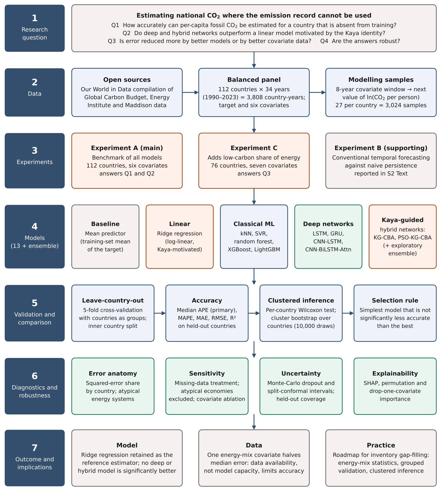

# KG-CBA: leave-country-out estimation of national CO₂ emissions — revision for PLOS Climate

Revised submission of the manuscript

> **Kaya-guided hybrid deep learning for leave-country-out estimation of national CO₂ emissions: a 112-country benchmark with country-clustered inference, conformal uncertainty, and explainable AI**
>
> Samiuel C. Atuahene, Bismark Boateng, Hilda Amarfio, Ekow Yaleh Quayson, Francis Boateng Agyenim
>
> CSIR – Institute of Industrial Research, Accra, Ghana · University of Ghana, Legon

**Status:** under revision at *PLOS Climate* (manuscript PCLM-D-26-00445). The documents in this repository are the revised submission and are not the published version of record.



## Main finding

Per-capita fossil CO₂ emissions of a country can be estimated from widely available energy and economic indicators, without any of its own emission data, with a median absolute percentage error of about 16% (112 countries, 1990–2023). A ridge regression motivated by the Kaya identity was not outperformed by any tree ensemble, deep network, Kaya-guided hybrid network or ensemble once countries, and not country-years, are treated as the unit of inference. Adding one energy-mix indicator, the low-carbon share of primary energy, halves the error (15.6% to 7.7% on 76 countries).

## Contents

| Folder | What it contains |
|---|---|
| [`revision/`](revision) | Response to Reviewers, revised manuscript (clean and with tracked changes) and cover letter, each as Word file and PDF |
| [`figures/`](figures) | Figures 1–8 as submitted (TIFF, 300 dpi); [`figures/png/`](figures/png) has PNG previews of all main and supporting figures |
| [`supporting_information/`](supporting_information) | S1 Text (supplementary methods), S2 Text (temporal forecasting experiment), S1 Table (countries and data audit), S2 Table (sensitivity analyses and additional results), S1–S6 Fig |
| [`data/`](data) | Harmonized panels used in the study and the two source files at the exact versions used |
| [`analysis/`](analysis) | Scripts for the analyses added in the revision, their outputs, and a script for tests from stored out-of-fold estimates |

## Data

| File | Description |
|---|---|
| `data/panel_112_countries.csv` | Balanced panel of 112 countries × 34 years (3,808 country-years): per-capita CO₂ (t per person), primary energy per capita (kWh per person), GDP per capita (international-$ per person, 2011 prices), population, and the coal, oil and gas shares of CO₂, with a flag for every value that was filled |
| `data/panel_enriched_76_countries.csv` | The 76 countries of Experiment C, with the low-carbon share of primary energy added |
| `data/owid-co2-data.csv` | Our World in Data CO₂ data set, repository [owid/co2-data](https://github.com/owid/co2-data), commit `382ee6c` (2 June 2026) |
| `data/owid-energy-data.csv` | Our World in Data energy data set, repository [owid/energy-data](https://github.com/owid/energy-data), commit `7e387a1` (27 April 2026) |

The source files redistribute the Global Carbon Budget 2025, the Energy Institute Statistical Review of World Energy 2025, the International Energy Data of the U.S. Energy Information Administration and the Maddison Project Database 2023. They are published by Our World in Data under the [Creative Commons BY 4.0 licence](https://creativecommons.org/licenses/by/4.0/); please cite the original sources when you reuse them.

## Reproducing the revision analyses

Requires Python 3.13 with numpy, pandas, scipy, scikit-learn, xgboost, lightgbm, shap, matplotlib, pillow and openpyxl.

```bash
cd analysis
python rev01_panel.py        # panel, descriptive statistics, fill audit
python rev03_imputation.py   # missing-data sensitivity
python rev04_outliers.py     # atypical economies excluded
python rev05_expC_xai.py     # Experiment C and covariate importance
python rev06_conformal.py    # conformal coverage for ridge regression
python rev07_tests.py        # country-clustered tests
python rev08_extra.py
python make_si_tables.py     # S1 Table and S2 Table
```

[`analysis/README.md`](analysis/README.md) lists what each script produces and which table or figure it supports, and gives the values the scripts must reproduce. The folder `analysis/out/` holds the outputs of the run reported in the revised manuscript.

The code of the neural networks (LSTM, GRU, CNN-LSTM, CNN-BiLSTM-Attn and the Kaya-guided hybrids) and their out-of-fold estimates belong to the original analysis pipeline and will be added to this repository before the archived release. With those estimates, `analysis/rev_tests_from_oof.py` computes the country-clustered tests of every model against ridge regression.

## Contact

Samiuel C. Atuahene, Emerging Engineering Technologies Division, CSIR – Institute of Industrial Research, East Legon, Accra, Ghana.
